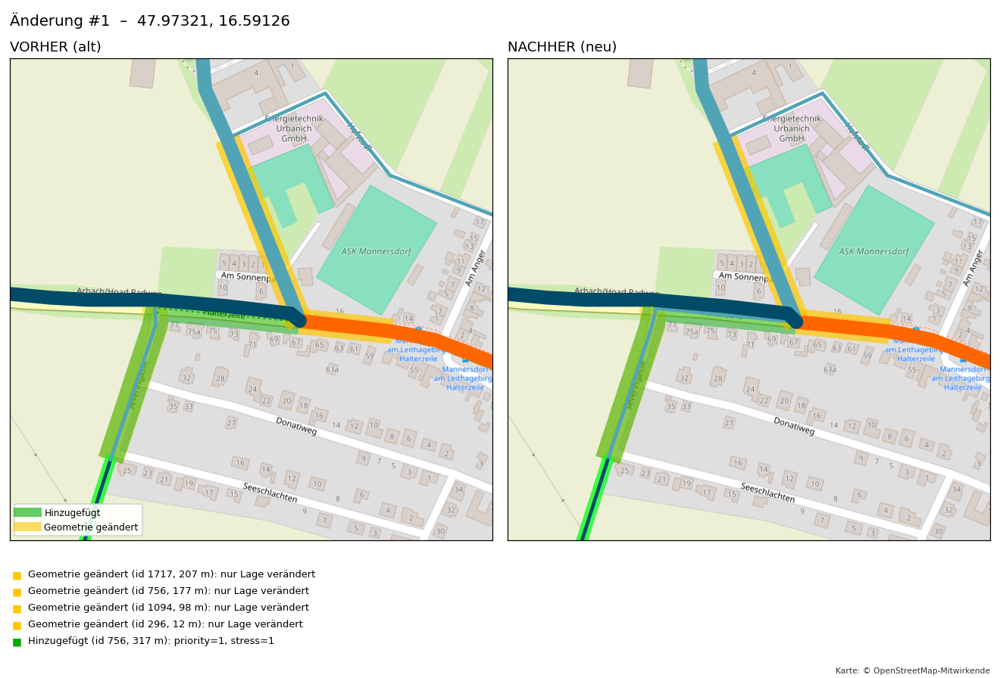

* Radlkarte Compare Python Skript

Das Python-Skript visualisiert die Unterschiede zwischen zwei GeoJSON-Dateien der
[[https://github.com/markusstraub/radlkarte][Radlkarte]] als Vorher/Nachher-Bilder. Es ist auf das Datenformat von radlkarte.at
abgestimmt (Attribute ~priority~, ~stress~, ~oneway~, ~unpaved~, ~steep~, ~fixme~,
~dismount~, ~warning~, ~nocargo~, ~description~ …). Ursprünglich großteils mit dem
KI-Modell qwen 3.8 entwickelt, Version 2 überarbeitet mit Claude.

** Funktionsweise

Verglichen werden *Geometrie und alle Attribute*.

1. Jede Linie wird in ihre Segmente (Stützpunkt → Stützpunkt) zerlegt, Punkte werden
   einzeln betrachtet. Koordinaten werden auf 5 Nachkommastellen gerundet – wie in
   ~prepare_geojson.py~ der Radlkarte.
2. Ein Segment gilt als unverändert, wenn es in der anderen Datei an derselben Stelle
   mit denselben Attributen vorkommt. Wird ein Weg in JOSM nur geteilt oder
   zusammengeführt, bekommt er eine neue id, oder ändert sich die Reihenfolge in der
   Datei, wird das deshalb *nicht* als Änderung gemeldet.
3. Jeder Unterschied wird einer Kategorie zugeordnet:

| Farbe   | Bedeutung          | Erklärung                                                                 |
|---------+--------------------+---------------------------------------------------------------------------|
| violett | Werte geändert     | gleiche Lage, andere Attribute (z. B. ~stress: 1 → 2~), inkl. umgedrehter Einbahn |
| gelb    | Geometrie geändert | Linie/Punkt verschoben oder verfeinert (alt und neu liegen max. 10 m auseinander) |
| rot     | Entfernt           | nur in der alten Datei                                                    |
| grün    | Hinzugefügt        | nur in der neuen Datei                                                    |

4. Nahe beieinander liegende Änderungen (Standard: 500 m) kommen in ein gemeinsames
   Bild. Wird ein Bild größer als 3 km, wird es weiter aufgeteilt.
5. Pro Bild wird ein PNG mit Vorher (links) und Nachher (rechts) erzeugt. Die Linien
   werden im Radlkarte-Stil gezeichnet, die Änderungen sind wie mit einem Textmarker
   darunter hinterlegt, sodass Farbe und Strichart der Radlkarte sichtbar bleiben.
   Unter den Karten steht eine Liste der Änderungen mit id, Länge sowie alten und
   neuen Werten. Als Hintergrund dienen OpenStreetMap-Kacheln (Web-Mercator,
   unverzerrt, Zoomstufe passend zur Bildgröße).
6. Zusätzlich wird ~aenderungen.csv~ geschrieben: alle Änderungen mit Bildname,
   Art, id alt/neu, Länge, Attribut, altem/neuem Wert und Koordinate
   (Strichpunkt-getrennt, öffnet direkt in Excel/LibreOffice).

#+CAPTION: Beispielausgabe (Radlkarte Wien, Commit 3b31ff1, hier ohne Hintergrundkarte)

** Installation

Repo klonen oder das Skript herunterladen. Benötigt werden nur:

#+begin_src bash
pip install matplotlib pillow
#+end_src

(geopandas, shapely und pyproj werden nicht mehr gebraucht.)

** Ausführung

#+begin_src bash
python3 radlkarte_compare.py datei_alt.geojson datei_neu.geojson [ausgabe_ordner] [max_renders] [cluster_distance_m] [Optionen]
#+end_src

Beispiel – zwei Versionen direkt aus dem Radlkarte-Repo vergleichen:

#+begin_src bash
git -C radlkarte show HEAD~1:data/radlkarte-wien.geojson > alt.geojson
git -C radlkarte show HEAD:data/radlkarte-wien.geojson   > neu.geojson
python3 radlkarte_compare.py alt.geojson neu.geojson ausgabe
#+end_src

*** Parameter

| Parameter            | Standard  | Bedeutung                                                          |
|----------------------+-----------+--------------------------------------------------------------------|
| ~datei_alt.geojson~  |           | Stand vor der Anpassung                                            |
| ~datei_neu.geojson~  |           | Stand nach der Anpassung                                           |
| ~ausgabe_ordner~     | ~ausgabe~ | Zielordner für PNGs und ~aenderungen.csv~                          |
| ~max_renders~        | ~0~       | max. Anzahl Bilder, ~0~ = alle                                     |
| ~cluster_distance_m~ | ~500~     | Änderungen näher als so viele *Meter* kommen in ein Bild           |

*** Optionen

| Option                  | Standard | Bedeutung                                                              |
|-------------------------+----------+------------------------------------------------------------------------|
| ~--schwelle M~          | ~10~     | bis zu diesem Abstand gelten entfernt + neu als "Geometrie geändert"   |
| ~--max-ausdehnung M~    | ~3000~   | größere Bilder werden aufgeteilt (~0~ = aus)                           |
| ~--rand M~              | ~80~     | Mindestrand um eine Änderung im Bild                                   |
| ~--ignoriere a,b~       | ~id~     | Attribute, die nicht verglichen werden                                 |
| ~--nur-geometrie~       |          | Attribute ignorieren (Verhalten der alten Version)                     |
| ~--genauigkeit N~       | ~5~      | Nachkommastellen beim Koordinatenvergleich                             |
| ~--ohne-karte~          |          | keine OSM-Hintergrundkarte laden (offline, schneller)                  |
| ~--max-zoom Z~          | ~18~     | höchste Zoomstufe der Hintergrundkarte                                 |
| ~--tile-url URL~        | OSM      | anderer Kachelserver, z. B. ~https://example.org/{z}/{x}/{y}.png~      |
| ~--tile-cache ORDNER~   | ~tile_cache~ | Zwischenspeicher für Kacheln                                       |

** Hinweis zu den OSM-Kacheln

Die Kacheln von tile.openstreetmap.org unterliegen der
[[https://operations.osmfoundation.org/policies/tiles/][Tile Usage Policy]]. Das Skript
sendet daher einen eindeutigen User-Agent, speichert alle Kacheln im Cache und lädt
pro Bild nur etwa 9–25 Kacheln. Für sehr große Vergleiche bitte ~max_renders~ nutzen
oder einen eigenen Kachelserver angeben.
